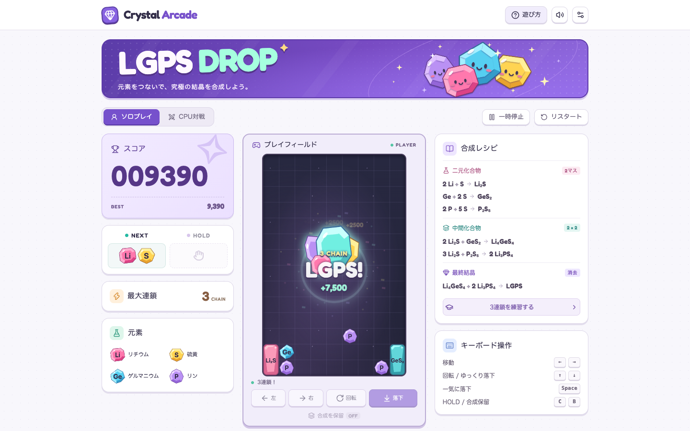
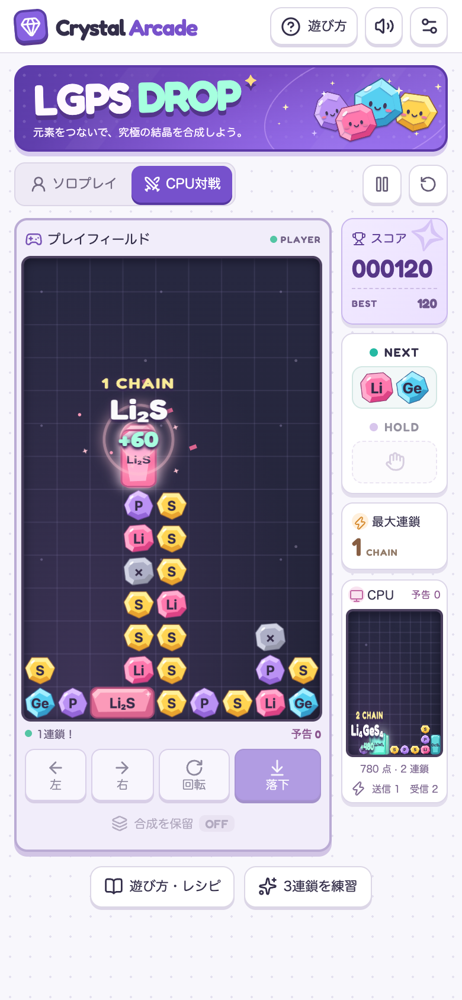

# LGPS DROP

**[ゲームを遊ぶ — GitHub Pages](https://ks250206.github.io/LGPS-drop/)**

ピンクのLi、黄色のS、水色のGe、紫のP。2個組の元素を落として、9×14マスの盤面で結晶を育てる落ちものパズルです。3連鎖から最終結晶 **Li₁₀GeP₂S₁₂（LGPS）** が生まれると、虹色の粒子とファンファーレが広がります。



## 最初の1分

- **3連鎖を練習する** を選んで、そのまま「落下」を1回。Li₂S → Li₃PS₄が2個 → LGPSという反応を、実際の盤面で体験できます。
- **ソロプレイ** は4種の元素を少し置いた盤面から開始。まずはLiを2個、Sを1個、上下左右につないでみてください。半透明の結晶が着地点です。
- **CPU対戦** は同じ盤面・同じ供給順でスタート。CPUも移動・回転した先の合法な配置を試算し、合成や盤面の高さを考えて落とします。



## 操作

| 操作                       | キーボード | タッチ           |
| -------------------------- | ---------- | ---------------- |
| 左右に移動                 | ← / →      | 左 / 右          |
| 時計回りに回転             | ↑ または Z | 回転             |
| 1マス落下 / 一気に落下     | ↓ / Space  | 落下で一気に着地 |
| 2個組を交換（着地まで1回） | C          | HOLD枠           |
| 自動合成の保留・解除       | B          | 合成を保留       |
| 一時停止・再開             | Esc        | 一時停止 / 再開  |

最初のゲーム操作で落下が始まります。音量ボタンでミュート、設定で演出の減光・軽減を切り替えられます。初期設定は端末の「視差効果を減らす」に対応。ベストスコア、音、演出の設定をブラウザに保存します。

## 合成レシピ

| 階層       | 隣接させる材料     | 出力         | 実占有サイズ         |
| ---------- | ------------------ | ------------ | -------------------- |
| 二元化合物 | 2 Li + S           | Li₂S         | 2×1 または 1×2       |
| 二元化合物 | Ge + 2 S           | GeS₂         | 同上                 |
| 二元化合物 | 2 P + 5 S          | P₂S₅         | 同上                 |
| 中間化合物 | 2 Li₂S + GeS₂      | Li₄GeS₄      | 2×2                  |
| 中間化合物 | 3 Li₂S + P₂S₅      | **2 Li₃PS₄** | **2×2 が2個**        |
| 最終結晶   | Li₄GeS₄ + 2 Li₃PS₄ | Li₁₀GeP₂S₁₂  | 大結晶の演出後に消去 |

LGPS 1個分の25原子は、二元化合物7個で14マス、中間化合物3個で12マスになります。すべて原子数を保存するゲーム用のレシピです。実際の合成条件はモデルの対象外です。

- 着地後、元素は個別に落下。合成済みの化合物は、端が1マス支えられていても全体で止まります。
- 合成に使えるのは、必要な種類・個数だけで上下左右につながる集合です。優先順はLGPS、Li₃PS₄、Li₄GeS₄、P₂S₅、GeS₂、Li₂Sです。
- 生成物ごとに少なくとも1マスは材料跡と重なる必要があります。2個生成する反応では両方の空きを先に確認します。置き場不足を表示したら、周囲の空きを増やしてください。
- 元素の袋はLi・Ge・P・Sをそれぞれ10・1・2・12個含み、袋ごとにシャッフルします。P₂S₅を狙うときは合成を保留してSを集め、解除後に次の組を着地させます。
- 同時合成はまとめて1回。重力処理の後に新たな合成が起きると連鎖が進み、基礎点に連鎖数を掛けます。失敗条件は入口の閉塞、対戦ではおじゃまが盤面上端に収まらない場合も含みます。

## 対戦のおじゃま

各反応段階で、合成の件数 ＋（連鎖数 − 1）＋ LGPS完成1個につき5個を攻撃に加算。連鎖の最後に、自分への予告を古い順に相殺し、余りを相手へ送ります。途中で届いたおじゃまは次の組で相殺でき、その組の連鎖終了時に最大6個が落ちます。灰色の「×」に隣接する材料を合成すれば除去できます。

初期版の対戦バランスです。CPUの強さは1段階。自然落下は両者とも約0.94秒で1マス、CPUの操作間隔は0.28秒以上です。

## ローカル実行

Node.js **26.13.0** と pnpm **12.21.0** を使用します。

```sh
pnpm install --frozen-lockfile
pnpm dev
```

ターミナルに表示されたURLの `/LGPS-drop/` を開きます。供給順を固定する場合は `?seed=1` のように整数を指定します。通常はプレイごとに新しいseedを使います。

```sh
pnpm typecheck
pnpm test
pnpm build
pnpm preview
```

TypeScript製のゲームエンジンは [src/game](src/game) にあり、DOMや描画から独立しています。React 19、Tailwind CSS 4、PixiJS 8の2D CanvasRendererでUIと盤面を描画し、短い効果音はWeb Audioで合成します。開発・テスト・本番ビルドにはVite+の `vp dev`、`vp test run`、`vp build` を使用します。[Vite+](https://viteplus.dev/guide/) · [PixiJS](https://pixijs.com/8.x/guides/components/application) · [Tailwind CSS](https://tailwindcss.com/docs/installation/using-vite)

## 検証と公開

- [エンジンテスト](tests/match.test.ts) で6レシピの原子収支、複数出力と置き場不足、剛体落下、壁際回転、優先順位、同時反応・連鎖、HOLD、保留、pause、CPUの自然落下・合法配置、相殺・決着を検証します。
- 実ブラウザでは通常ソロのseed 1をキーボードで操作し、12手でLGPS、最大3連鎖、9,390点を確認。練習でも落下1回でLGPSが完成します。
- READMEの画像は本番ビルドの実プレイをChromiumで撮影しました。デスクトップは1440×900、スマホは390×844のタッチエミュレーションです。対戦はゲームオーバーと再スタートまで検証しました。
- [GitHub Actions](https://github.com/ks250206/LGPS-drop/actions/workflows/pages.yml) が固定lockfileで依存をインストールし、型チェック・テスト・ビルドを実行します。mainの成功時にdistをPagesへ公開します。
